<p align="center">
  <a href="https://vibecook-dev.github.io/truffle/">
    <picture>
      <source media="(prefers-color-scheme: dark)" srcset=".github/readme/hero-dark.svg">
      
    </picture>
  </a>
</p>

<p align="center">
  <b>Your devices, talking to each other directly.</b><br>
  TCP, UDP, QUIC, WebSocket and HTTP between the machines on your tailnet,<br>
  plus messaging, file transfer and synced state. No server to run.
</p>

<p align="center">
  <a href="https://vibecook-dev.github.io/truffle/"><b>Docs</b></a>&nbsp;&nbsp;·&nbsp;
  <a href="https://vibecook-dev.github.io/truffle/api.html">API</a>&nbsp;&nbsp;·&nbsp;
  <a href="#examples">Examples</a>&nbsp;&nbsp;·&nbsp;
  <a href="benchmark/README.md">Benchmarks</a>&nbsp;&nbsp;·&nbsp;
  <a href="CHANGELOG.md">Changelog</a>
</p>

<p align="center">
  <a href="https://github.com/vibecook-dev/truffle/actions/workflows/ci.yml"><picture><source media="(prefers-color-scheme: dark)" srcset="https://img.shields.io/github/actions/workflow/status/vibecook-dev/truffle/ci.yml?branch=main&label=ci&style=flat-square&labelColor=262624&color=fafaf7"></picture></a>
  <a href="https://www.npmjs.com/package/@vibecook/truffle"><picture><source media="(prefers-color-scheme: dark)" srcset="https://img.shields.io/npm/v/%40vibecook%2Ftruffle?label=npm&style=flat-square&labelColor=262624&color=fafaf7"></picture></a>
  <a href="https://crates.io/crates/truffle"><picture><source media="(prefers-color-scheme: dark)" srcset="https://img.shields.io/crates/v/truffle?label=crates.io&style=flat-square&labelColor=262624&color=fafaf7"></picture></a>
  <a href="LICENSE"><picture><source media="(prefers-color-scheme: dark)" srcset="https://img.shields.io/badge/license-MIT-fafaf7?style=flat-square&labelColor=262624"></picture></a>
</p>

<br>

<p align="center">
  <picture>
    <source media="(prefers-color-scheme: dark)" srcset=".github/readme/demo-dark.svg">
    
  </picture>
</p>

## Hello, mesh

```ts
import { createMeshNode } from '@vibecook/truffle';

const mesh = await createMeshNode({ appId: 'notes' });

// Hear from every device running the same app
mesh.onMessage('chat', (msg) => console.log(msg.payload));

// Find one, and talk to it
const bob = await mesh.peer('bob-laptop', { waitMs: 5000 });
await bob?.sendJson('chat', { text: 'hello' });

// Or use the sockets you already know
mesh.net.createServer((socket) => socket.pipe(socket)).listen(7000);
```

## No server in the middle

<p align="center">
  <picture>
    <source media="(prefers-color-scheme: dark)" srcset=".github/readme/direct-dark.svg">
    
  </picture>
</p>

Tailscale carries the bytes and knows who everyone is. truffle gives your code the APIs.

## What you get

<table>
  <tr>
    <td width="33%" valign="top">
      <picture><source media="(prefers-color-scheme: dark)" srcset=".github/readme/tile-transports-dark.svg">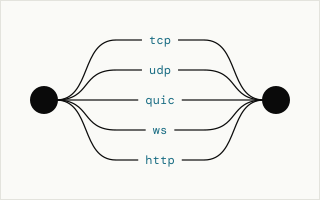</picture>
      <b>Five transports</b><br>
      <code>mesh.net</code>, <code>http</code>, <code>dgram</code>, <code>ws</code> and <code>quic</code>, shaped like the Node.js modules.
    </td>
    <td width="33%" valign="top">
      <picture><source media="(prefers-color-scheme: dark)" srcset=".github/readme/tile-peers-dark.svg">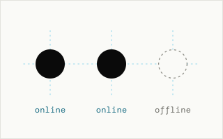</picture>
      <b>Peers</b><br>
      Devices running your app find each other. You hold a <code>Peer</code>, not an address.
    </td>
    <td width="33%" valign="top">
      <picture><source media="(prefers-color-scheme: dark)" srcset=".github/readme/tile-messages-dark.svg">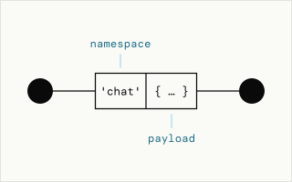</picture>
      <b>Messages</b><br>
      <code>peer.sendJson('chat', …)</code>, routed by namespace. Send to one peer or broadcast to all.
    </td>
  </tr>
  <tr>
    <td width="33%" valign="top">
      <picture><source media="(prefers-color-scheme: dark)" srcset=".github/readme/tile-files-dark.svg">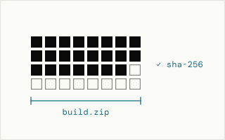</picture>
      <b>Files</b><br>
      Send a file to a peer. Every transfer is checked with SHA-256.
    </td>
    <td width="33%" valign="top">
      <picture><source media="(prefers-color-scheme: dark)" srcset=".github/readme/tile-stores-dark.svg">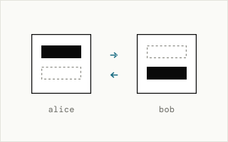</picture>
      <b>Synced stores</b><br>
      Each device owns its slice of the state and sees everyone else's.
    </td>
    <td width="33%" valign="top">
      <picture><source media="(prefers-color-scheme: dark)" srcset=".github/readme/tile-serve-dark.svg">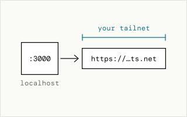</picture>
      <b>Serve</b><br>
      <code>mesh.serve()</code> puts a local port or folder on your tailnet, with HTTPS.
    </td>
  </tr>
</table>

## Install

All you need is a Tailscale account. truffle brings its own Tailscale node, and the first run opens a sign-in link.

```bash
# In your app (Node.js 18+)
pnpm add @vibecook/truffle

# The CLI: macOS and Linux
curl -fsSL https://vibecook-dev.github.io/truffle/install.sh | sh

# The CLI: Windows (PowerShell)
iwr -useb https://vibecook-dev.github.io/truffle/install.ps1 | iex
```

<details>
<summary>Swift and Rust</summary>

<br>

```swift
// Package.swift (iOS 18.1+)
.package(url: "https://github.com/vibecook-dev/truffle.git", from: "0.7.7")
```

```bash
cargo add truffle
```

</details>

## How it works

<p align="center">
  <picture>
    <source media="(prefers-color-scheme: dark)" srcset=".github/readme/stack-dark.svg">
    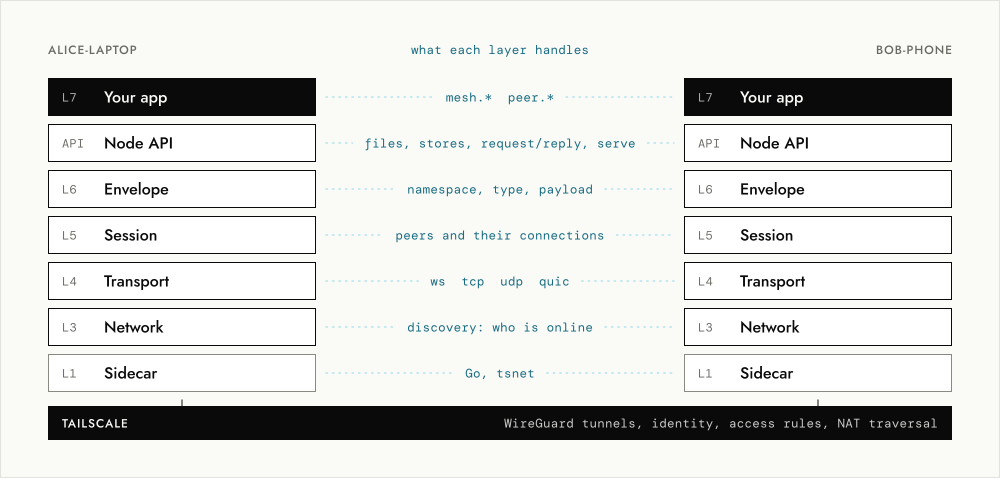
  </picture>
</p>

`appId` is the boundary: devices only see peers running the same app. One exception is HTTP you publish with `mesh.serve`, which your whole tailnet can open.

## Measure it yourself

<p align="center">
  <picture>
    <source media="(prefers-color-scheme: dark)" srcset=".github/readme/bench-dark.png">
    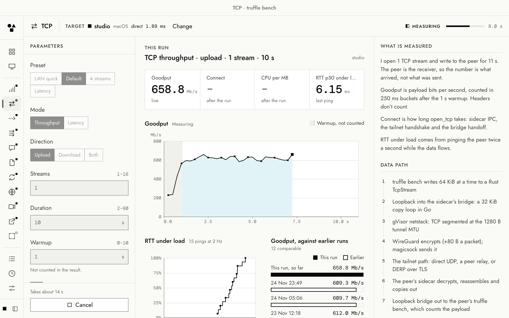
  </picture>
</p>

<p align="center"><sub><b>truffle bench</b> runs ten workloads between your own machines. Shown here with its built-in demo data. <a href="benchmark/README.md">Methods and results</a></sub></p>

## Packages

| | Where | What |
| --- | --- | --- |
| [`@vibecook/truffle`](packages/core) | npm | The JavaScript and TypeScript API |
| [`@vibecook/truffle-react`](packages/react) | npm | React hooks: `useMesh`, `useAuth`, `useSyncedStore` |
| [`truffle`](crates/truffle-cli) CLI | install script | 14 commands and an interactive TUI, with `--json` for agents |
| [`truffle`](crates/truffle), [`truffle-core`](crates/truffle-core) | crates.io | The Rust core |
| [Truffle Swift](apple/) | SwiftPM | The same mesh on iOS, wire compatible |
| [`truffle-tauri-plugin`](crates/truffle-tauri-plugin) | this repo | Tauri v2 plugin |
| [truffle bench](benchmark/) | this repo | Benchmark engine, CLI and desktop app |

Runs on macOS, Linux and Windows. The Swift package runs on iOS 18.1 and later.

## Examples

Ten runnable demos in [`examples/`](examples/): discovery, chat, shared state, netcat over TCP, QUIC streams, Express over the mesh, a static site with an API, exposing a dev server, WebSocket chat, and an Electron playground. For Swift there is [`MeshChatDemo`](apple/Examples/MeshChatDemo).

## Docs

[Guide](https://vibecook-dev.github.io/truffle/) · [API reference](https://vibecook-dev.github.io/truffle/api.html) · [Serving HTTP](docs/guide/serving-http.md) · [API stability](docs/API-STABILITY.md) · [Testing](docs/TESTING.md) · [Releasing](docs/RELEASING.md) · [RFCs](docs/rfcs/)

<details>
<summary><b>Development</b></summary>

<br>

```bash
pnpm install
cargo build --locked --workspace --exclude truffle-tauri-plugin --exclude truffle-napi --exclude truffle-bench-app
cargo test --locked --workspace --exclude truffle-tauri-plugin --exclude truffle-napi --exclude truffle-bench-app
pnpm run build
pnpm run test
```

A plain `cargo build` builds only the default members, with no GUI crates. Benchmarks are covered in [benchmark/README.md](benchmark/README.md).

```bash
# Swift package (macOS, Xcode toolchain)
cd apple && DEVELOPER_DIR=/Applications/Xcode.app/Contents/Developer swift test

# Enable the pre-commit hook, once per clone
git config core.hooksPath .githooks
```

</details>

<br>

<p align="center">
  <a href="https://github.com/jamesyong-42">
    <picture>
      <source media="(prefers-color-scheme: dark)" srcset=".github/readme/james-yong-dark.svg">
      
    </picture>
  </a>
</p>

<p align="center">
  <sub><a href="LICENSE">MIT</a> © 2026 James Yong. truffle is a <a href="https://github.com/vibecook-dev">vibecook</a> project, built independently on Tailscale and not affiliated with Tailscale Inc.</sub>
</p>
